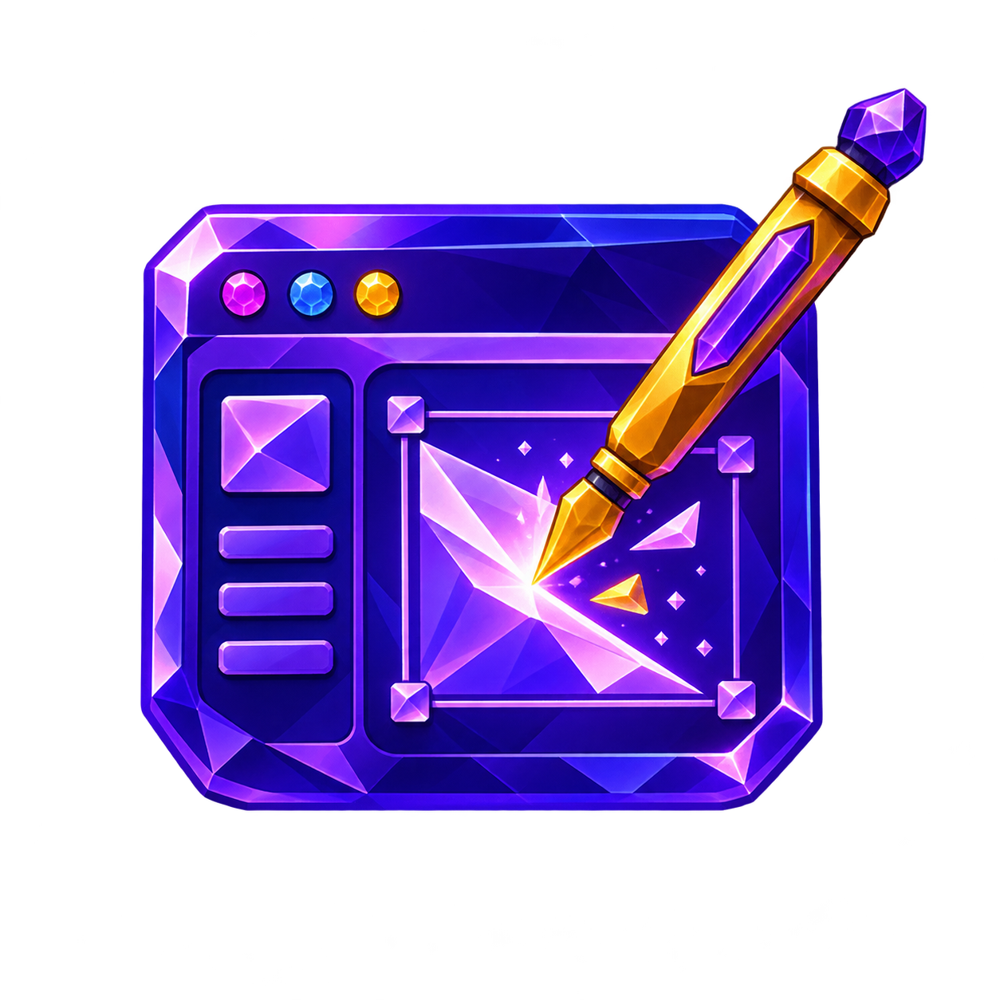
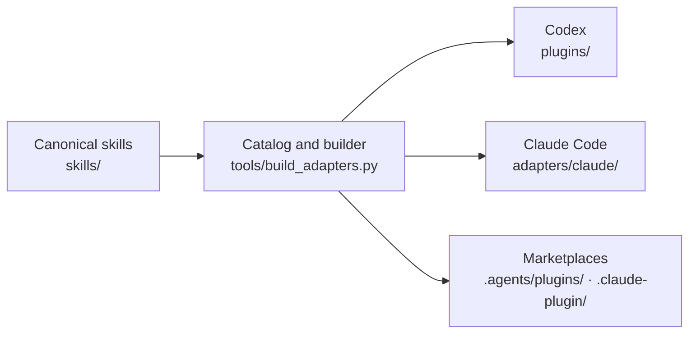

<div align="center">

# Statusnone Agent Skills

**One canonical skill library. Two agent hosts. Fifteen deliberate workflows.**

`Codex` · `Claude Code` · Windows and macOS

</div>

---

Statusnone Agent Skills is a private, versioned workflow library for planning, implementation,
review, communication, and agent coordination. Codex and Claude Code receive the same four plugins
and 15 skill names on Windows and macOS. Host-specific behavior stays inside generated adapters;
Mac uses the same packages and does not need a separate adapter.

## The catalog

| | Plugin | Purpose | Skills |
|---|---|---|---|
|  | **Engineering Workflows** | Design, diagnose, test, review, and document real repository work. | `grill-me` · `domain-modeling` · `diagnosing-bugs` · `comment-discipline` · `tdd` · `codebase-design` · `conceptual-review` · `contract-review` · `repository-docs` · `maintaining-docs` |
|  | **Communication Tools** | Explain technical work clearly or compress it without losing critical information. | `english` · `concise` |
|  | **Agent Control** | Coordinate native subagents or run an adaptive build-and-verify workflow. | `orchestrate` · `superpowers` |
|  | **Frontend Design** | Give interfaces a distinctive, intentional visual direction. | `frontend-design` |

## Host parity

Both hosts expose the same catalog. Each adapter uses the host's native capabilities.

| Host | Invocation | `orchestrate` behavior | Manual-use boundary |
|---|---|---|---|
| **Codex** | `$skill-name` | Select models and reasoning effort from the current session's supported choices. | Enforced with `allow_implicit_invocation: false`. |
| **Claude Code** | `/plugin-name:skill-name` | Use native Claude model controls and supported effort or inheritance. | Enforced with `disable-model-invocation: true`. |

Both orchestration variants preserve the user's selected parent model, explicit subagent choices,
authorization, and final verification in the parent. Model roles are not tied to fixed releases.
When a requested choice is unavailable, the agent reports the limitation instead of silently
substituting. Claude Code's variant contains no Codex model names or custom agent framework.

## Distribution model



`skills/` is the only canonical workflow source. Plugin and marketplace metadata live in one catalog
at the top of `tools/build_adapters.py`. Host copies, plugin manifests, and both marketplace files
are generated and must never be edited by hand. Cursor/Grok Bot and ZCode are retired; their
artwork is preserved in `assets/retired-hosts/`.

## Invocation contract

- Every skill is designed for deliberate user selection.
- Delegation never expands the user's authorization, repository scope, or allowed side effects.
- Codex and Claude Code enforce manual invocation in metadata.

## Repository map

| Path | Role |
|---|---|
| `skills/` | Canonical skill instructions, assets, and host variants. |
| `tools/build_adapters.py` | Plugin catalog and the builder for every generated file. |
| `plugins/` | Generated Codex skills plus Codex plugin manifests. |
| `adapters/claude/plugins/` | Generated Claude Code distribution. |
| `assets/plugins/` | Canonical plugin artwork. |
| `assets/retired-hosts/` | Preserved artwork from retired adapters, with SHA-256 fingerprints. |
| `.agents/plugins/marketplace.json` | Generated Codex marketplace. |
| `.claude-plugin/marketplace.json` | Generated Claude Code marketplace. |

## Rebuild and verify

Edit skills under `skills/` and plugin metadata in the catalog in `tools/build_adapters.py`, then
run:

```sh
python3 tools/build_adapters.py
python3 tools/build_adapters.py --check
python3 -m unittest discover -s tests -v
claude plugin validate . --strict
```

The verification suite rebuilds every generated file in a temporary folder and compares it byte for
byte with the committed copy. It also checks exact skill membership, manual-use metadata,
marketplace links, text files under 16 KB, host-specific orchestration, attribution, the absence of
workflow hooks, and preserved artwork from retired hosts. Also validate all canonical and generated
Codex skills with Codex's `quick_validate.py`, and each Claude plugin with
`claude plugin validate PATH --strict`.
Windows can use `python` in place of `python3`; set `PYTHONUTF8=1` for validators that use the
platform's default text encoding.

## Patch release and installed copies

The September 2026 patch release uses Agent Control `0.3.1`, Communication Tools `0.4.1`,
Engineering Workflows `0.5.1`, and Frontend Design `0.1.1` on both hosts. All 15 skills remain.

Repository updates and installed plugin caches are separate. After an approved release, update the
registered source and refresh the installed packages through each host's plugin manager. Restart
the host or use a fresh session, then verify the selected skill path and contents. Do not edit
cached skills by hand. Each Windows or Mac installation must be checked separately; passing
repository checks on one machine does not establish runtime acceptance on the other.

## Attribution and licensing

See [ORIGIN.md](ORIGIN.md), [NOTICE.md](NOTICE.md), and [LICENSE](LICENSE). Most of this repository is
MIT licensed. `skills/frontend-design/` is an Apache-2.0 adaptation and retains its own
`LICENSE.txt`. Third-party inspirations and adaptations are attributed without implying
endorsement.
