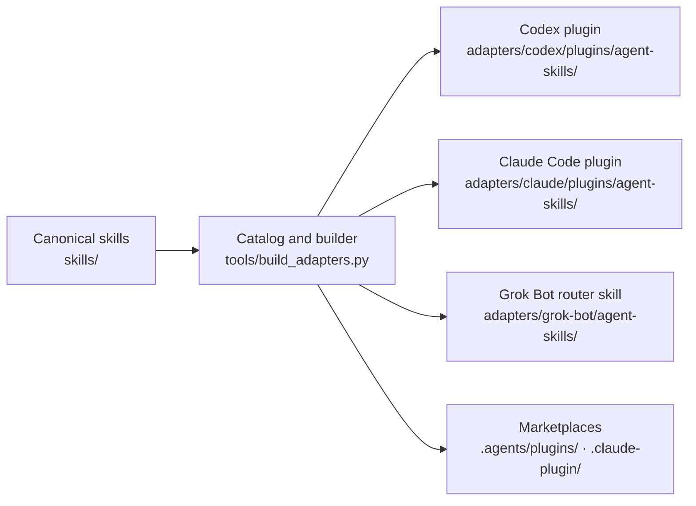

<div align="center">


# Agent Skills

**One suite. Nine focused skills. Codex, Claude Code, and Grok Bot.**

`Codex` · `Claude Code` · `Grok Bot` · Windows and macOS

</div>

---

Agent Skills is Statusnone's versioned skill suite for codebase design, debugging, reviews,
documentation, plain-English answers, frontend design, and subagent coordination. It ships as one
plugin, `agent-skills`, from the `statusnone-agent-skills` marketplace. Every skill is a peer inside
that plugin; there are no sub-plugins. For Grok Bot, the same nine skills ship as one router skill.

## The skills

| | Skill | What it does | Loads |
|---|---|---|---|
|  | `codebase-design` | Designs deep modules: small interfaces, real seams, tests at the interface. | On its own |
|  | `conceptual-review` | Checks a plan, technical claim, or implementation spec before work starts. | On its own |
|  | `concise` | Gives the shortest complete reply without dropping facts or next steps. | On its own |
|  | `diagnosing-bugs` | Finds root causes of hard bugs, flaky tests, and performance regressions. | On its own |
|  | `english` | Explains technical text or the current situation in plain English, without acting. | Manual only |
|  | `frontend-design` | Gives web interfaces a distinctive, deliberate visual direction. | On its own |
|  | `maintaining-docs` | Updates repository docs from verified evidence. | On its own |
|  | `orchestrate` | Runs focused subagents while the parent keeps decisions and final checks. | Manual only |
|  | `repository-docs` | Finds and loads the repository guidance a task needs. | On its own |

**On its own** means the agent loads the skill when a request matches its description. You can also
call it by name. **Manual only** means the skill runs only when you call it: `orchestrate` starts
subagents, which cost time and tokens, and `english` refuses tool use, which would stop real work if
it fired by itself.

## Calling a skill

| Host | Call it by name | Manual-only setting |
|---|---|---|
| **Claude Code** | `/agent-skills:english`, or `/english` when no other command uses that name | `disable-model-invocation: true` |
| **Codex** | `$agent-skills:english`. Plain `$english` does not find a plugin skill. | `allow_implicit_invocation: false` |
| **Grok Bot** | Name it in your message, such as "use agent-skills english" | The router runs every skill only when you name it |

The catalog in `tools/build_adapters.py` sets each skill's mode, and tests check that the generated
Codex and Claude Code settings match it. Delegation never expands the user's authorization,
repository scope, or allowed side effects.

Both `orchestrate` variants keep the user's selected parent model, explicit subagent choices,
authorization, and final verification in the parent. Model roles are not tied to fixed releases.
When a requested choice is unavailable, the agent reports the limitation instead of silently
substituting. The Claude Code variant contains no Codex model names or custom agent framework.

## Load the skills

**Checked** means we ran it here on Windows with the host version named, or this repository's own
checks, a host's CLI help, or a host's validator confirmed it. Each label says which. **Docs** means
it comes from the host's documentation but was not run end to end here. **Reported** means the
host's own agent described it, but it was not run end to end here.
**Unverified** means it is our best reading and still needs a real test.

### Claude Code (terminal, IDE, and the Code tab in Claude Desktop)

```sh
claude plugin marketplace add Statusnone420/agent-skills
claude plugin install agent-skills@statusnone-agent-skills
```

In a session on Claude Code 2.1.275 or later, one line works too:
`/plugin install agent-skills --marketplace Statusnone420/agent-skills`. Update with
`claude plugin marketplace update statusnone-agent-skills`, then
`claude plugin update agent-skills@statusnone-agent-skills`. Call a skill with
`/agent-skills:english`. **Checked** on Claude Code 2.1.302: the two install commands,
`/agent-skills:english`, `/english`, and `diagnosing-bugs` loading on its own. `english` and
`orchestrate` were not among the skills the model could call. Strict plugin validation passes. The
update commands and the one-line install are checked by command name only.

### Claude on the web and Claude Desktop chat

Zip one folder from `skills/`, such as `skills/concise/`, so that the zip holds that folder with its
`SKILL.md`. Upload it in **Customize → Skills** and switch it on. Upload from `skills/`, not
`adapters/`: uploads reject the `disable-model-invocation` line in the Claude Code copies, so
uploaded skills can always load on their own. Skip `english` and `orchestrate` there. **Docs.**
Claude Desktop chat uses the skills on your claude.ai account. **Unverified.**

### Codex (CLI and the Codex app)

```sh
codex plugin marketplace add Statusnone420/agent-skills
codex plugin add agent-skills@statusnone-agent-skills
```

You can also install from `/plugins` in a session. Start a new session after installing, and refresh
later with `codex plugin marketplace upgrade`. Call a skill with `$agent-skills:english`; plain
`$english` does not find it. **Checked** on Codex CLI 0.162.1: `codex plugin add`, the upgrade,
`$agent-skills:english`, and `diagnosing-bugs` loading on its own. Codex lists only the seven
automatic skills to the model, so `english` and `orchestrate` did not load on their own.
`codex plugin marketplace add` is checked by CLI help, and every skill passes `quick_validate.py`.
**Unverified:** `/plugins` and the Codex app. The IDE extension does not support plugins. **Docs.**

### ChatGPT

Eligible Business, Enterprise, Healthcare, and Edu workspaces can add skills in **Plugins → Plugin
Directory → Skills → Create → Upload from your computer**. Upload a zipped folder from `skills/`.
**Docs**; the zip format is **Unverified**. Workspace admins can also import this repository's Codex
marketplace. **Docs.** On other plans, use Codex.

### Grok Build CLI

```sh
grok plugin marketplace add Statusnone420/agent-skills
grok plugin install agent-skills --trust
grok plugin enable agent-skills
```

Grok reads the Claude Code marketplace, so it needs no separate copy. If Claude Code already has the
marketplace, Grok sees it too and the first line fails with "already configured"; skip it. Plugins
start disabled. `grok plugin enable` lists `agent-skills` under `[plugins] enabled` in
`~/.grok/config.toml`; the Plugins tab works too. Call a skill with `/agent-skills:english`.
**Checked** on Grok 1.0.52 with Claude Code installed: install, enable, `/agent-skills:english`, and
`diagnosing-bugs` loading on its own. With Claude Code's copy of this repository at the current
layout, `english` and `orchestrate` were not among the skills the model could call, and a
plain-English question did not load `english`. `grok plugin validate` accepts the plugin. **Docs:**
the Plugins tab. **Unverified:** installing on a machine without Claude Code.

`grok inspect` shows that Grok looks first for `plugins/<name>/` in Claude Code's copy of this
repository and ignores the marketplace `source`. Older copies held the Codex plugin there, which has
no `disable-model-invocation` line, so `english` and `orchestrate` could load on their own. If
`grok inspect` lists the skills under `marketplaces/statusnone-agent-skills/plugins/agent-skills/`,
refresh that copy with `claude plugin marketplace update statusnone-agent-skills`.

### Cursor and Grok Bot

- **Cursor agents**, including Grok models in Cursor: copy the folders in
  `adapters/claude/plugins/agent-skills/skills/` to `~/.cursor/skills/` for every project, or to
  `.cursor/skills/` for one. Use these copies because Cursor honors their
  `disable-model-invocation` line. **Docs.**
- **Grok Bot** (xAI's agent app, included with paid Cursor plans): copy
  `adapters/grok-bot/agent-skills/` into Grok Bot's skills folder, so that the folder holds
  `agent-skills/SKILL.md` and `agent-skills/skills/`. The folder also carries `LICENSE`,
  `NOTICE.md`, and `ORIGIN.md`, so the copy keeps its license and attribution. That one router skill
  holds all nine skills and runs each only when you name it, such as "use agent-skills english". It also tells Grok Bot how to
  read Codex and Claude Code terms such as subagents and `$codebase-design`. To update, replace the
  folder with a fresh copy; the last line of its `SKILL.md` gives the version and a fingerprint that
  changes whenever the bundle changes. **Reported** by Grok Bot; xAI's Grok Bot docs do not describe
  the folder. **Unverified:** a full run of the bundle in Grok Bot.

## Upgrading from the four plugins

Until October 2026 this repository shipped four plugins: Engineering Workflows, Communication Tools,
Agent Control, and Frontend Design. `agent-skills` replaces all four. Hosts keep installed copies of
the old plugins until you remove them.

Claude Code:

```sh
claude plugin marketplace update statusnone-agent-skills
claude plugin uninstall engineering-workflows@statusnone-agent-skills
claude plugin uninstall communication-tools@statusnone-agent-skills
claude plugin uninstall agent-control@statusnone-agent-skills
claude plugin uninstall frontend-design@statusnone-agent-skills
claude plugin install agent-skills@statusnone-agent-skills
```

New installs on Claude Code 2.1.275 or later can use one line in a session:
`/plugin install agent-skills --marketplace Statusnone420/agent-skills`.

Codex, removing only the old plugins you have:

```sh
codex plugin marketplace upgrade
codex plugin remove engineering-workflows@statusnone-agent-skills
codex plugin remove communication-tools@statusnone-agent-skills
codex plugin remove agent-control@statusnone-agent-skills
codex plugin remove frontend-design@statusnone-agent-skills
codex plugin add agent-skills@statusnone-agent-skills
```

Then start a new session. **Checked** on Codex CLI 0.162.1: these steps replaced all four old
plugins with `agent-skills` 1.1.0.

## Distribution model



`skills/` is the only canonical workflow source. Suite metadata and each skill's invocation mode
live in one catalog at the top of `tools/build_adapters.py`. Host copies, the Grok Bot router, plugin
manifests, and both marketplace files are generated and must never be edited by hand. Mac uses the
same packages and needs no separate adapter. The Codex plugin and the Grok Bot bundle stay out of a
top-level `plugins/` folder: Grok Build loads that folder from Claude Code's copy of this repository
and ignores the marketplace `source`. A test enforces this.

## Repository map

| Path | Role |
|---|---|
| `skills/` | Canonical skill instructions, assets, and host variants. |
| `tools/build_adapters.py` | Suite catalog and the builder for every generated file. |
| `adapters/codex/plugins/agent-skills/` | Generated Codex plugin. |
| `adapters/claude/plugins/agent-skills/` | Generated Claude Code plugin. |
| `adapters/grok-bot/agent-skills/` | Generated Grok Bot router skill, its copies of the nine skills, and the license files. |
| `assets/plugins/agent-skills/` | Suite artwork. |
| `assets/retired-skills/` | Preserved artwork from retired skills. |
| `assets/retired-plugins/` | Preserved artwork from the four retired plugins. |
| `assets/retired-hosts/` | Preserved artwork from retired adapters, with SHA-256 fingerprints. |
| `.agents/plugins/marketplace.json` | Generated Codex marketplace. |
| `.claude-plugin/marketplace.json` | Generated Claude Code marketplace. |

## Rebuild and verify

Edit skills under `skills/` and suite metadata in the catalog in `tools/build_adapters.py`, then
run:

```sh
python3 tools/build_adapters.py
python3 tools/build_adapters.py --check
python3 -m unittest discover -s tests -v
claude plugin validate . --strict
```

The verification suite rebuilds every generated file in a temporary folder and compares it byte for
byte with the committed copy. It also checks the one-suite layout, each skill's invocation setting,
that only the Claude Code plugin can sit where Grok looks for it, a "Use when" trigger line in every
description, text files under 16 KB, host-specific orchestration, attribution, the absence of
workflow hooks, and preserved artwork. It checks that the Grok Bot bundle copies `skills/` exactly,
minus artwork, host variants, and host-only frontmatter, carries the license and attribution files,
and has a fingerprint that covers every bundled byte. Also validate all canonical and generated
Codex and Grok Bot skills with Codex's `quick_validate.py`, and the Claude plugin with
`claude plugin validate PATH --strict`.
Windows can use `python` in place of `python3`; set `PYTHONUTF8=1` for validators that use the
platform's default text encoding.

## Retired

- **Skills, October 2026:** `superpowers` (its stop-after-two-failed-fixes rule moved into
  `diagnosing-bugs`), `contract-review` (merged into `conceptual-review` as spec mode),
  `domain-modeling`, `comment-discipline` (now a short rule for personal agent instructions),
  `grill-me`, and `tdd`. Their icons are in `assets/retired-skills/`.
- **Plugins, October 2026:** Engineering Workflows, Communication Tools, Agent Control, and Frontend
  Design, replaced by `agent-skills`. The Engineering Workflows icon became the suite icon; the other
  three are in `assets/retired-plugins/`.
- **Hosts, September 2026:** the Cursor/Grok Bot and ZCode adapters. Their artwork is in
  `assets/retired-hosts/`. Grok Bot came back in October 2026 as the generated router skill.

## Releases and installed copies

Version `1.1.0` refreshes `frontend-design` and adds the load instructions above. Version `1.0.0` was
the first `agent-skills` release. Repository updates and installed plugin caches are separate. After an approved release, refresh the marketplace and update the installed plugin
through each host's plugin manager. Restart the host or use a fresh session, then verify the
selected skill path and contents. Do not edit cached skills by hand. Each Windows or Mac
installation must be checked separately; passing repository checks on one machine does not
establish runtime acceptance on the other.

## Attribution and licensing

See [ORIGIN.md](ORIGIN.md), [NOTICE.md](NOTICE.md), and [LICENSE](LICENSE). Most of this repository is
MIT licensed. `skills/frontend-design/` is an Apache-2.0 adaptation and keeps its own `LICENSE.txt`,
so the plugin manifests declare `MIT AND Apache-2.0`. `codebase-design` and `diagnosing-bugs` adapt
MIT-licensed work, so each keeps a copy of `LICENSE` as `LICENSE.txt`. That way, every adapted skill
keeps its license when you upload or copy its folder on its own. The Grok Bot bundle is copied out of
the repository on its own, so it carries copies of `LICENSE`, `NOTICE.md`, and `ORIGIN.md`.
Third-party inspirations and adaptations are attributed without implying endorsement.
