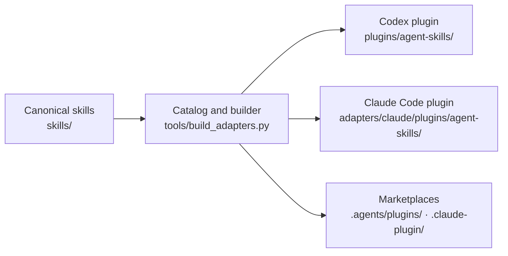

<div align="center">


# Agent Skills

**One suite. Nine focused skills. Codex and Claude Code.**

`Codex` · `Claude Code` · Windows and macOS

</div>

---

Agent Skills is Statusnone's versioned skill suite for codebase design, debugging, reviews,
documentation, plain-English answers, frontend design, and subagent coordination. It ships as one
plugin, `agent-skills`, from the `statusnone-agent-skills` marketplace. Every skill is a peer inside
that plugin; there are no sub-plugins.

## The skills

| | Skill | What it does | Loads |
|---|---|---|---|
|  | `codebase-design` | Designs deep modules: small interfaces, real seams, tests at the interface. | On its own |
|  | `conceptual-review` | Checks a plan, technical claim, or implementation spec before work starts. | On its own |
|  | `concise` | Gives the shortest complete reply without dropping facts or next steps. | On its own |
|  | `diagnosing-bugs` | Finds root causes of hard bugs, flaky tests, and performance regressions. | On its own |
|  | `english` | Explains technical text or the current situation in plain English, without acting. | Manual only |
|  | `frontend-design` | Gives web interfaces a distinctive, deliberate visual direction. | On its own |
|  | `maintaining-docs` | Updates repository docs from verified evidence. | On its own |
|  | `orchestrate` | Runs focused subagents while the parent keeps decisions and final checks. | Manual only |
|  | `repository-docs` | Finds and loads the repository guidance a task needs. | On its own |

**On its own** means the agent loads the skill when a request matches its description. You can also
call it by name. **Manual only** means the skill runs only when you call it: `orchestrate` starts
subagents, which cost time and tokens, and `english` refuses tool use, which would stop real work if
it fired by itself.

## Calling a skill

| Host | Call it by name | Manual-only setting |
|---|---|---|
| **Claude Code** | `/agent-skills:english`, or `/english` when no other command uses that name | `disable-model-invocation: true` |
| **Codex** | Pick it with `$`. Codex source names plugin skills `agent-skills:english`; not yet tested here. | `allow_implicit_invocation: false` |

The catalog in `tools/build_adapters.py` sets each skill's mode, and tests check that the generated
Codex and Claude Code settings match it. Delegation never expands the user's authorization,
repository scope, or allowed side effects.

Both `orchestrate` variants keep the user's selected parent model, explicit subagent choices,
authorization, and final verification in the parent. Model roles are not tied to fixed releases.
When a requested choice is unavailable, the agent reports the limitation instead of silently
substituting. The Claude Code variant contains no Codex model names or custom agent framework.

## Upgrading from the four plugins

Until October 2026 this repository shipped four plugins: Engineering Workflows, Communication Tools,
Agent Control, and Frontend Design. `agent-skills` replaces all four. Hosts keep installed copies of
the old plugins until you remove them.

Claude Code:

```sh
claude plugin marketplace update statusnone-agent-skills
claude plugin uninstall engineering-workflows@statusnone-agent-skills
claude plugin uninstall communication-tools@statusnone-agent-skills
claude plugin uninstall agent-control@statusnone-agent-skills
claude plugin uninstall frontend-design@statusnone-agent-skills
claude plugin install agent-skills@statusnone-agent-skills
```

New installs on Claude Code 2.1.275 or later can use one line in a session:
`/plugin install agent-skills --marketplace Statusnone420/agent-skills`.

Codex: refresh the `statusnone-agent-skills` marketplace, remove the four old plugins in
`/plugins`, install `agent-skills`, and start a new session. These Codex steps follow Codex's
documentation and have not been tested here.

## Distribution model



`skills/` is the only canonical workflow source. Suite metadata and each skill's invocation mode
live in one catalog at the top of `tools/build_adapters.py`. Host copies, plugin manifests, and both
marketplace files are generated and must never be edited by hand. Mac uses the same packages and
needs no separate adapter.

## Repository map

| Path | Role |
|---|---|
| `skills/` | Canonical skill instructions, assets, and host variants. |
| `tools/build_adapters.py` | Suite catalog and the builder for every generated file. |
| `plugins/agent-skills/` | Generated Codex plugin. |
| `adapters/claude/plugins/agent-skills/` | Generated Claude Code plugin. |
| `assets/plugins/agent-skills/` | Suite artwork. |
| `assets/retired-skills/` | Preserved artwork from retired skills. |
| `assets/retired-plugins/` | Preserved artwork from the four retired plugins. |
| `assets/retired-hosts/` | Preserved artwork from retired adapters, with SHA-256 fingerprints. |
| `.agents/plugins/marketplace.json` | Generated Codex marketplace. |
| `.claude-plugin/marketplace.json` | Generated Claude Code marketplace. |

## Rebuild and verify

Edit skills under `skills/` and suite metadata in the catalog in `tools/build_adapters.py`, then
run:

```sh
python3 tools/build_adapters.py
python3 tools/build_adapters.py --check
python3 -m unittest discover -s tests -v
claude plugin validate . --strict
```

The verification suite rebuilds every generated file in a temporary folder and compares it byte for
byte with the committed copy. It also checks the one-suite layout, each skill's invocation setting,
a "Use when" trigger line in every description, text files under 16 KB, host-specific
orchestration, attribution, the absence of workflow hooks, and preserved artwork. Also validate all
canonical and generated Codex skills with Codex's `quick_validate.py`, and the Claude plugin with
`claude plugin validate PATH --strict`. Windows can use `python` in place of `python3`; set
`PYTHONUTF8=1` for validators that use the platform's default text encoding.

## Retired

- **Skills, October 2026:** `superpowers` (its stop-after-two-failed-fixes rule moved into
  `diagnosing-bugs`), `contract-review` (merged into `conceptual-review` as spec mode),
  `domain-modeling`, `comment-discipline` (now a short rule for personal agent instructions),
  `grill-me`, and `tdd`. Their icons are in `assets/retired-skills/`.
- **Plugins, October 2026:** Engineering Workflows, Communication Tools, Agent Control, and Frontend
  Design, replaced by `agent-skills`. The Engineering Workflows icon became the suite icon; the other
  three are in `assets/retired-plugins/`.
- **Hosts, September 2026:** the Cursor/Grok Bot and ZCode adapters. Their artwork is in
  `assets/retired-hosts/`.

## Releases and installed copies

Version `1.0.0` is the first `agent-skills` release. Repository updates and installed plugin caches
are separate. After an approved release, refresh the marketplace and update the installed plugin
through each host's plugin manager. Restart the host or use a fresh session, then verify the
selected skill path and contents. Do not edit cached skills by hand. Each Windows or Mac
installation must be checked separately; passing repository checks on one machine does not
establish runtime acceptance on the other.

## Attribution and licensing

See [ORIGIN.md](ORIGIN.md), [NOTICE.md](NOTICE.md), and [LICENSE](LICENSE). Most of this repository is
MIT licensed. `skills/frontend-design/` is an Apache-2.0 adaptation and keeps its own `LICENSE.txt`,
so the plugin manifests declare `MIT AND Apache-2.0`. Third-party inspirations and adaptations are
attributed without implying endorsement.
